# AI 论文辅助系统 — 系统架构说明书

## 1. 引言

### 1.1 编写目的
本文档描述 **AI 论文辅助系统（AIM）** 的整体架构、关键技术决策、模块职责、部署形态与关键流程。本文档与《需求分析说明.md》配套使用，作为后续详细设计与运维参考。

### 1.2 架构原则
- **前后端分离**：Vue3 SPA + FastAPI RESTful API，便于多端接入；
- **分层清晰**：表示层 / 接口层 / 业务层 / 数据层 / 基础设施层；
- **领域驱动**：按业务领域拆分 `routers/` 与 `schemas/`；
- **无状态后端**：所有会话状态由 JWT 承载，便于水平扩展；
- **数据隔离**：所有用户数据按 `uid` 进行严格隔离；
- **异步友好**：CPU/IO 密集任务（如 LLM 调用）走线程池，不阻塞事件循环；
- **可演进**：LLM、Embedding、文档解析均可替换。

### 1.3 架构视图说明
本文档采用扩展自 4+1 视图模型的多视角描述：
| 视图 | 关注点 | 对应章节 |
|------|--------|---------|
| 上下文视图 | 系统边界、外部依赖 | §2 |
| 逻辑视图 | 分层、模块划分 | §3、§4 |
| 进程视图 | 并发、异步、线程池 | §6 |
| 物理视图 | 部署、网络、运行时 | §7 |
| 数据视图 | 存储、流向、模型 | §5 |
| 场景视图 | 关键链路 / 用例 | §8 |

---

## 2. 系统上下文（Context View）

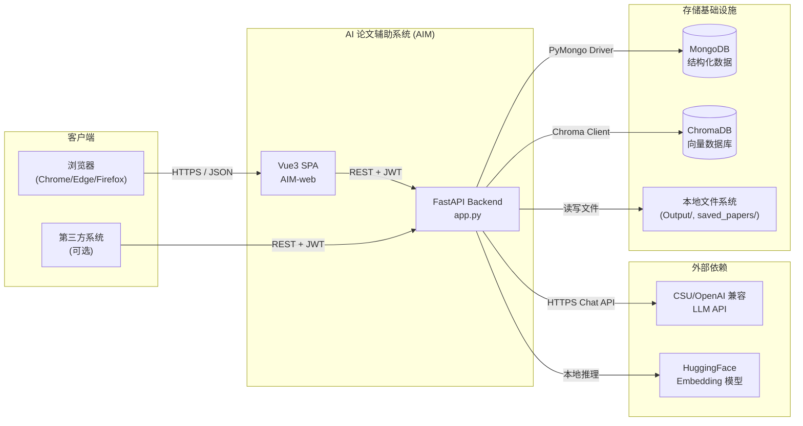

---

## 3. 总体逻辑架构（分层视图）

系统从顶向下划分为五层：

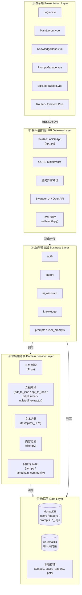

> 说明：业务层 (`routers/`) 当前直接调用领域服务（如 `AI.py`、`mongodb.py`、`textspliter_LLM`）。将来可在 §10 演进路线中抽出独立的 Service 子层进一步解耦。

---

## 4. 模块组件视图（Component View）

### 4.1 后端模块结构

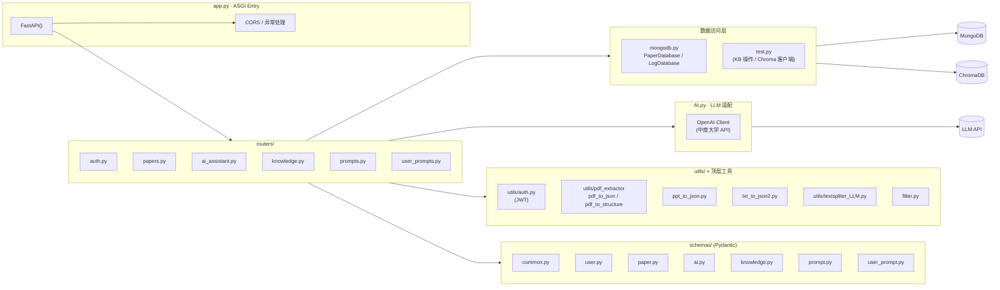

### 4.2 前端模块结构

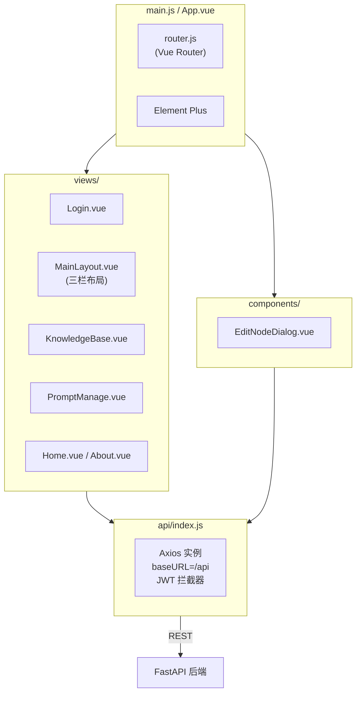

### 4.3 后端 API 路由总览

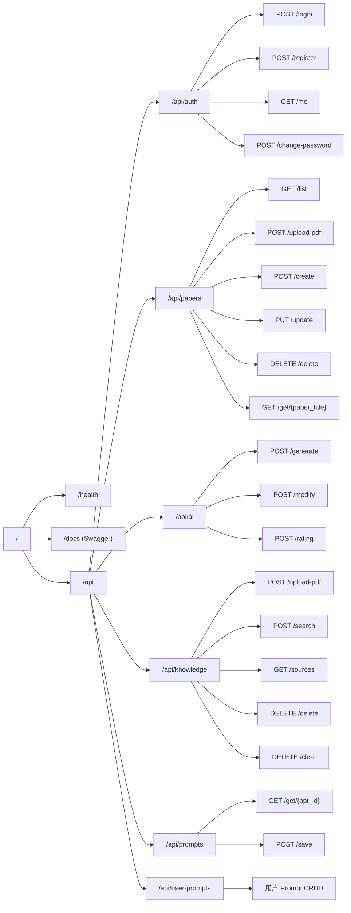

---

## 5. 数据视图（Data View）

### 5.1 数据存储分布

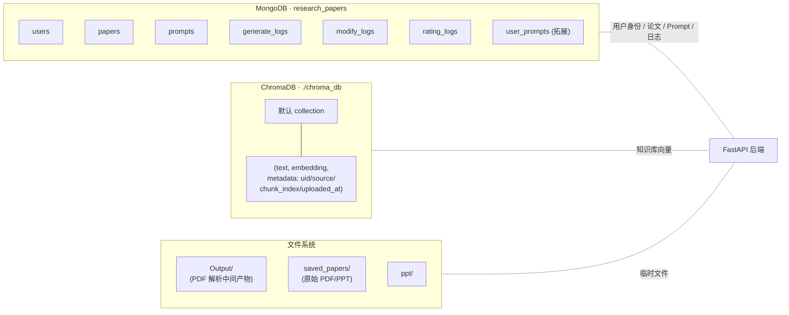

### 5.2 数据流：从 PPT/PDF 到论文

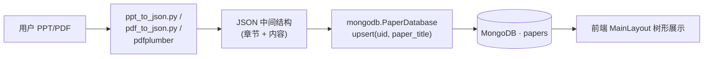

### 5.3 数据流：知识库 RAG

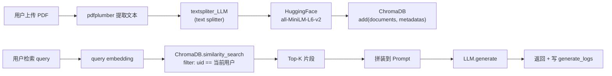

---

## 6. 进程与并发视图（Runtime View）

### 6.1 运行时进程模型

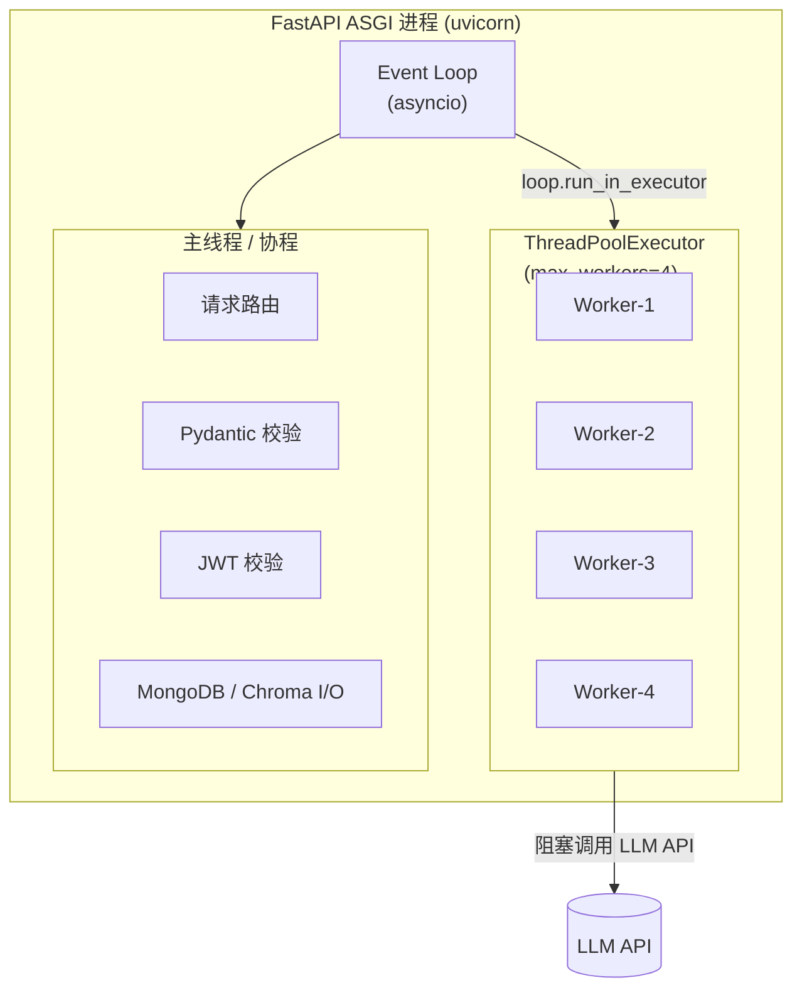

> AI 生成/修改这类阻塞 I/O 调用通过 `ThreadPoolExecutor` 卸载到 worker 线程，避免阻塞事件循环；其他轻量数据库操作仍可在协程上下文执行。

### 6.2 生产部署进程模型

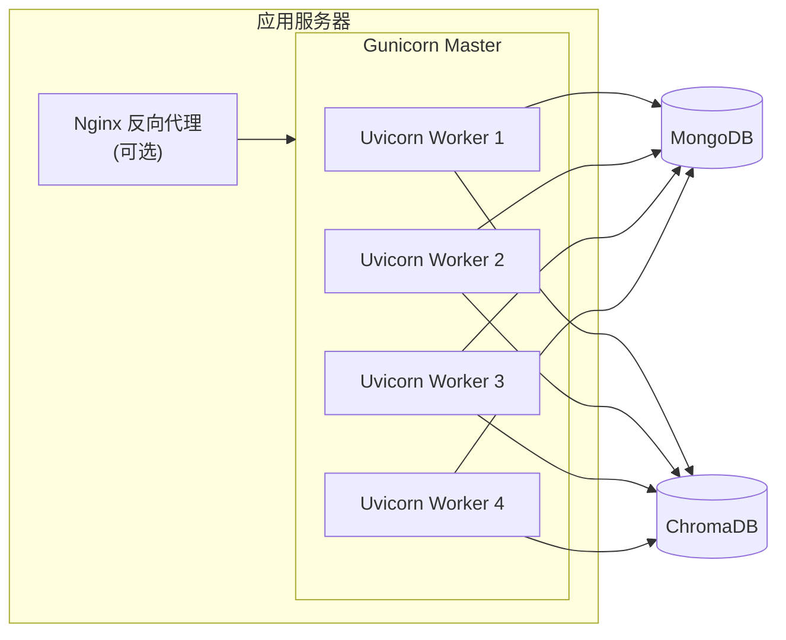

---

## 7. 部署架构（Deployment View）

### 7.1 开发环境

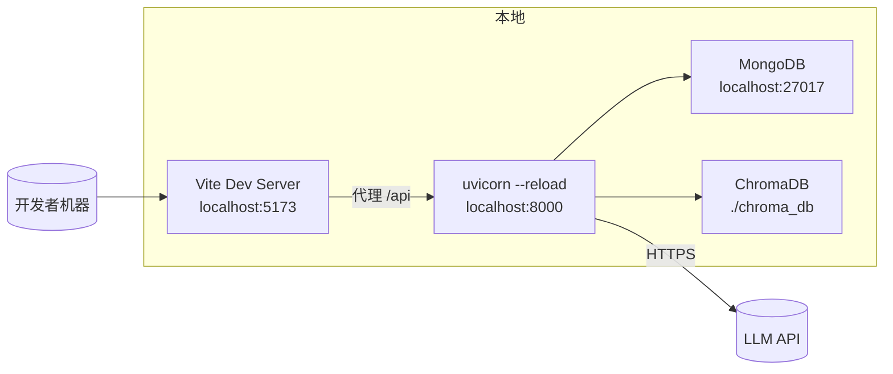

### 7.2 生产环境（推荐拓扑）

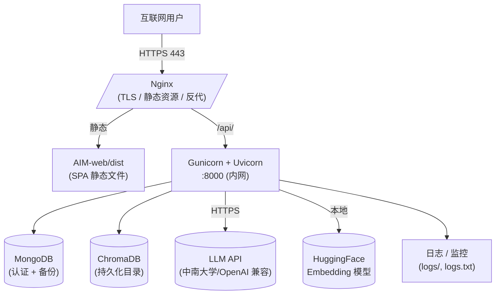

### 7.3 启动脚本与端口

| 角色 | 启动命令 | 监听 | 备注 |
|------|----------|------|------|
| 后端开发 | `python app.py` 或 `start_backend.sh` | 8000 | 自带 reload |
| 后端生产 | `start_backend_prod.sh`（gunicorn + uvicorn） | 8000 (内网) | 受 Nginx 反代 |
| 前端开发 | `npm run dev`（Vite） | 5173 | 浏览器直接访问 |
| 前端生产 | `npm run build` + `start_frontend_prod.sh` | 80 | Nginx 提供静态文件 |
| MongoDB | 系统服务 | 27017 | 建议启用认证 |
| ChromaDB | 嵌入式 / 本地目录 | — | `./chroma_db` |

---

## 8. 关键场景视图（Scenario View）

### 8.1 登录鉴权链路

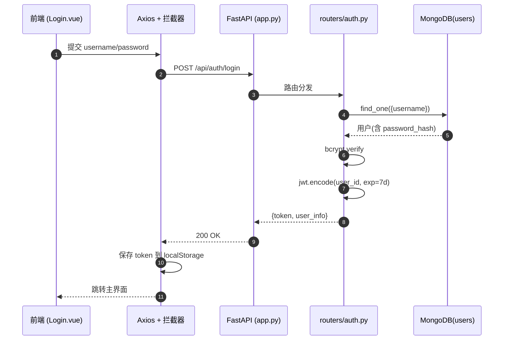

### 8.2 AI 生成（核心 RAG 链路，含线程池）

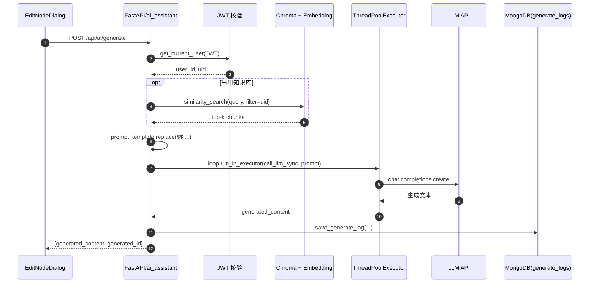

### 8.3 知识库 PDF 入库链路

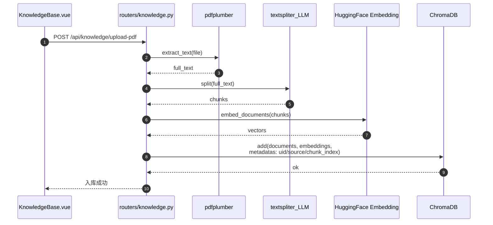

### 8.4 论文从 PDF 上传到树形展示

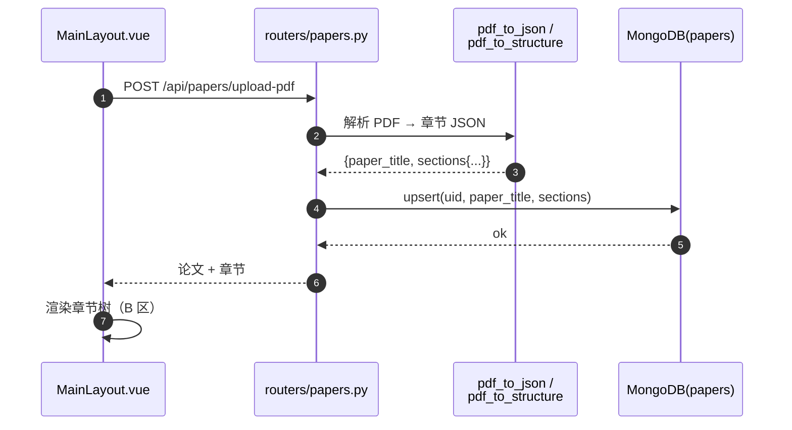

---

## 9. 横切关注点（Cross-Cutting Concerns）

### 9.1 安全架构

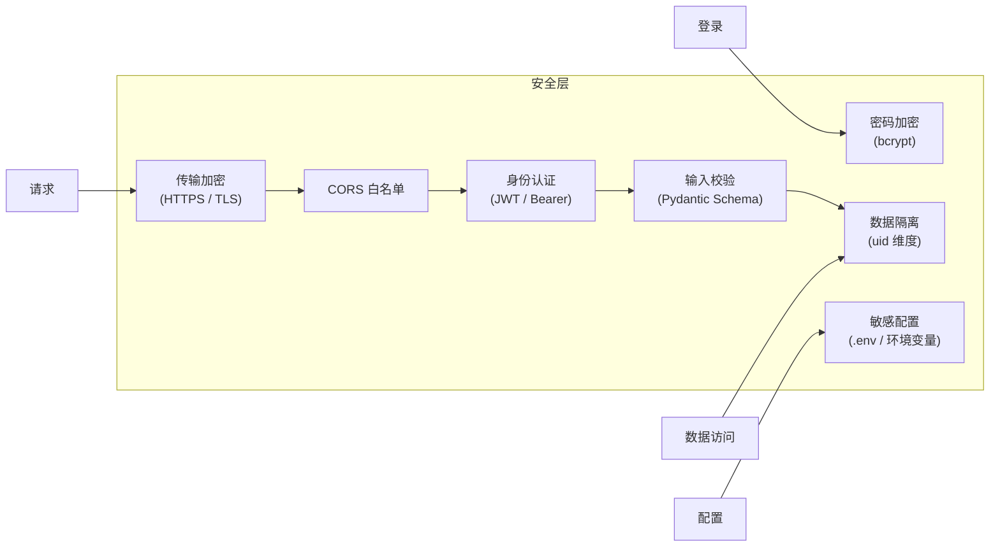

### 9.2 可观测性
- 日志：后端进程日志写入 `logs/` 与 `logs.txt`；
- 数据库审计：`generate_logs` / `modify_logs` / `rating_logs` 三类业务日志；
- 健康检查：`/health` 返回 `status=healthy + timestamp`；
- API 文档：`/docs` 自动生成 OpenAPI（Swagger UI）。

### 9.3 配置管理
- `config.py` 统一聚合配置，敏感项通过 `dotenv` 从 `.env` 注入；
- 关键配置项：`JWT_SECRET_KEY`、`MONGODB_URL`、`CHROMA_PERSIST_DIR`、`OPENAI_API_KEY`、`EMBEDDING_MODEL`、`MAX_UPLOAD_SIZE`。

### 9.4 错误处理
- 业务错误：`HTTPException(status_code, detail)`；
- 校验错误：由 Pydantic 自动返回 422；
- 兜底异常：`@app.exception_handler(Exception)` 返回统一 `{success, message, data}` 格式。

---

## 10. 技术选型与依赖关系

### 10.1 技术栈速查

| 维度 | 选型 | 理由 |
|------|------|------|
| 后端框架 | FastAPI 0.116 | 异步、自带 OpenAPI、Pydantic 校验 |
| 前端框架 | Vue3 + Vite | 学习曲线低、生态完善、HMR 极快 |
| UI 库 | Element Plus | 中文友好、组件齐全 |
| 主存储 | MongoDB | 论文/章节天然为文档结构 |
| 向量库 | ChromaDB | 嵌入式、上手简单 |
| Embedding | all-MiniLM-L6-v2 | 多语言、轻量、可本地部署 |
| LLM SDK | langchain + openai | 兼容 OpenAI 协议、便于切换 |
| LLM 服务 | 中南大学 API（OpenAI 兼容） | 当前可用、已有密钥 |
| 鉴权 | PyJWT + bcrypt | 标准方案 |
| PDF 解析 | pdfplumber / PyPDF2 | 文本抽取效果较好 |
| 异步执行 | asyncio + ThreadPoolExecutor | 避免阻塞事件循环 |

### 10.2 依赖关系图（核心组件）

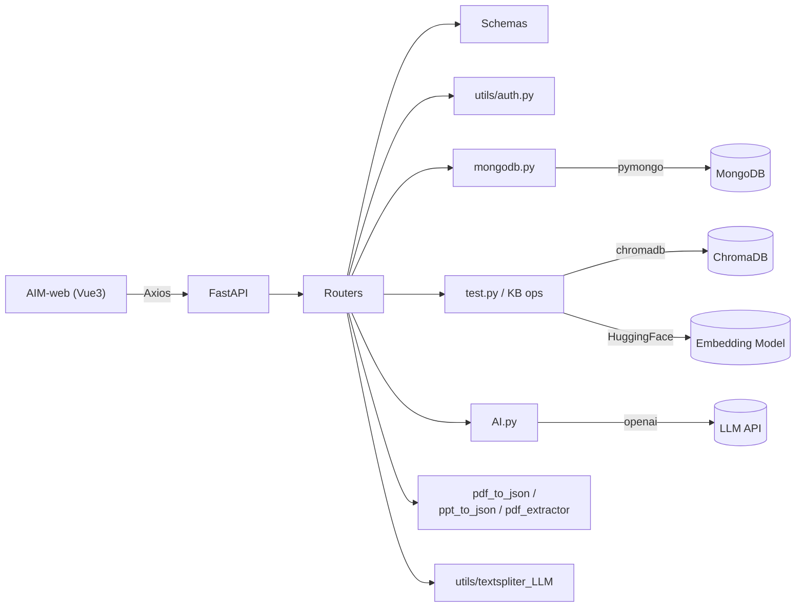

---

## 11. 演进与扩展路线（Roadmap）

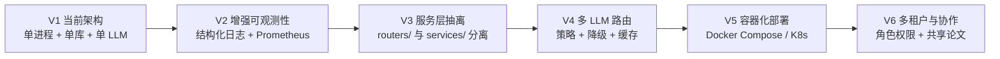

### 11.1 短期建议
- 抽出独立的 `services/` 子层，承接现在散落在 routers 中的业务逻辑；
- 将 `mongodb.py` 中的 `LogDatabase` / `PaperDatabase` 拆分到 `repositories/`；
- 将 `AI.py` 中的硬编码密钥迁移至 `.env`；
- 为 `/api/ai/generate` 增加调用超时、限流与重试策略；
- 为 ChromaDB 写入路径加上批量与失败回滚。

### 11.2 中期建议
- 引入 Redis 做 Token 黑名单、检索缓存与 LLM 响应缓存；
- 将 LLM 调用改造为基于 LangChain 的 Chain/Agent，便于编排；
- 引入异步 MongoDB 驱动 Motor；
- 建立 CI/CD 流水线（Lint + 测试 + Docker 镜像）。

### 11.3 长期建议
- 容器化 + K8s 部署，多副本横向扩展；
- 支持多 LLM 后端（OpenAI / Gemini / Qianfan / 本地模型）路由策略；
- 引入工作流引擎（LangGraph 等）支持更复杂的写作 Agent；
- 引入多用户协作（共享论文、协同编辑、变更历史）。

---

## 12. 架构风险登记表

| 编号 | 风险描述 | 影响 | 等级 | 缓解措施 |
|------|----------|------|------|----------|
| R-1 | LLM API 不稳定 / 限流 | 生成功能不可用 | 高 | 超时 + 重试 + 多 LLM 备份 |
| R-2 | ChromaDB 单实例无高可用 | 知识库不可用 | 中 | 定期备份目录，按用户分片 |
| R-3 | MongoDB 未启用认证 | 数据泄漏风险 | 高 | 生产启用 auth + 网络隔离 |
| R-4 | 后端无限流 | DoS 风险 | 中 | 引入 slowapi / Nginx 限流 |
| R-5 | `JWT_SECRET_KEY` 默认值 | Token 伪造 | 高 | 强制环境变量配置 |
| R-6 | PDF 解析对中文复杂排版不稳健 | 章节结构错误 | 中 | 增加多解析器策略 + 人工修正 UI |
| R-7 | 业务逻辑分散在 routers 中 | 维护成本上升 | 中 | 抽出 service / repository 层 |
| R-8 | Embedding 模型首次下载慢 | 启动体验差 | 低 | 镜像预热或离线模型 |

---

## 13. 与需求的对齐（追溯）

| 关键非功能需求 | 架构决策 |
|----------------|----------|
| 安全性（NFR-S1~S5） | JWT、bcrypt、Pydantic、CORS、`.env` 配置 |
| 性能（NFR-P1~P4） | 异步路由、线程池、向量库语义检索 |
| 可维护性（NFR-M1~M3） | 路由/Schema/工具分层、Swagger 自动文档 |
| 可扩展性（NFR-E1~E3） | LLM 适配 (`AI.py`)、Embedding 可换、Pydantic 开放扩展 |
| 可用性（NFR-A1~A3） | 全局异常、健康检查、业务日志三件套 |

---

## 附录 A：架构决策记录（ADR 摘要）

| ADR | 决策 | 备注 |
|-----|------|------|
| ADR-001 | 选择 FastAPI 而非 Flask/Django | 异步 + 自动 OpenAPI |
| ADR-002 | 选择 MongoDB 而非关系库 | 论文/章节为天然嵌套文档结构 |
| ADR-003 | 选择 ChromaDB 而非 FAISS/Milvus | 嵌入式、上手简单、易迁移 |
| ADR-004 | LLM 同步 SDK + ThreadPoolExecutor 包装 | 既兼容 SDK 又不阻塞协程 |
| ADR-005 | 前端用 Vue3 + Element Plus | 中文项目生态友好 |
| ADR-006 | JWT 无状态认证 | 便于水平扩展 |

---

## 附录 B：典型目录到分层的映射

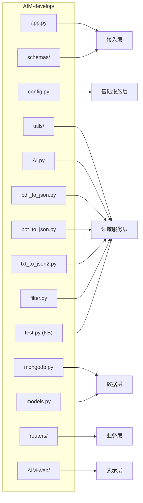

---

> 本文档与《需求分析说明.md》互为参考；如代码后续演进（如新增 service 层、容器化部署），请同步更新本文档对应章节。
