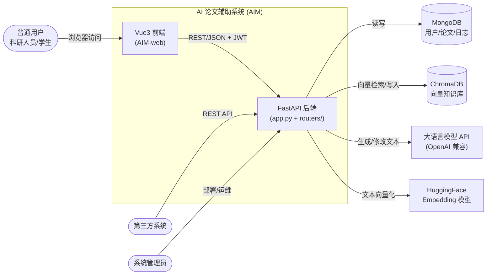
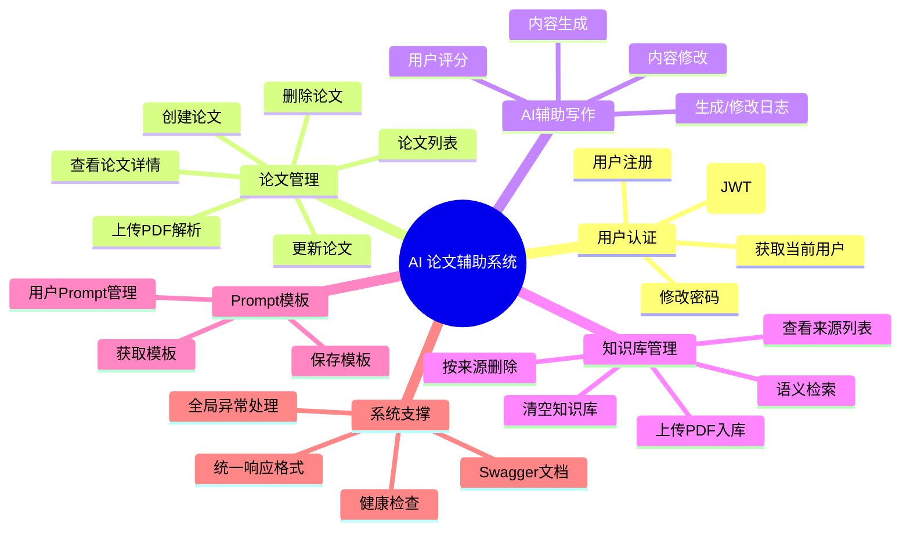
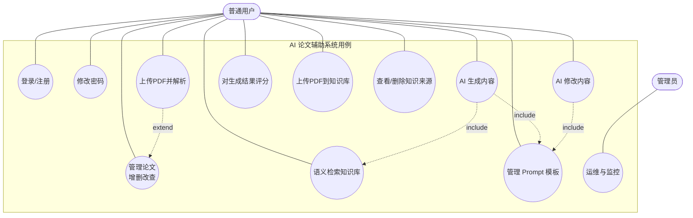
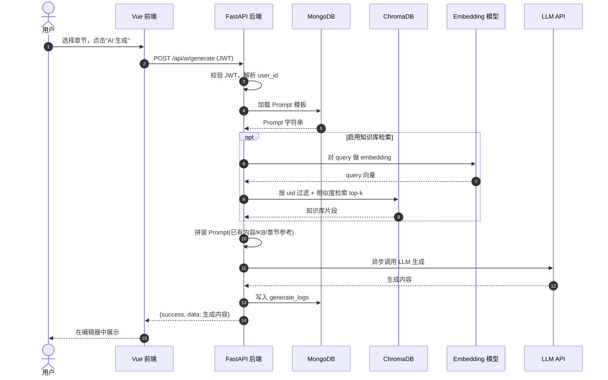
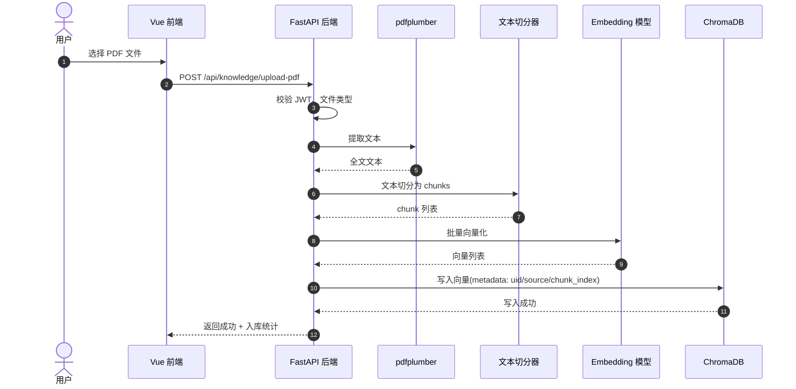
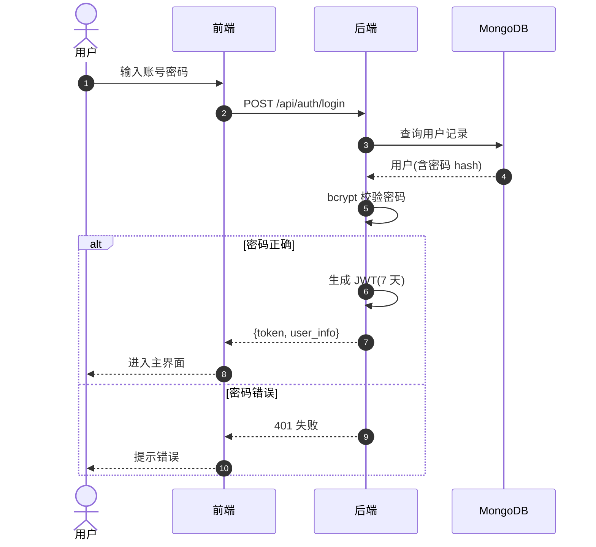
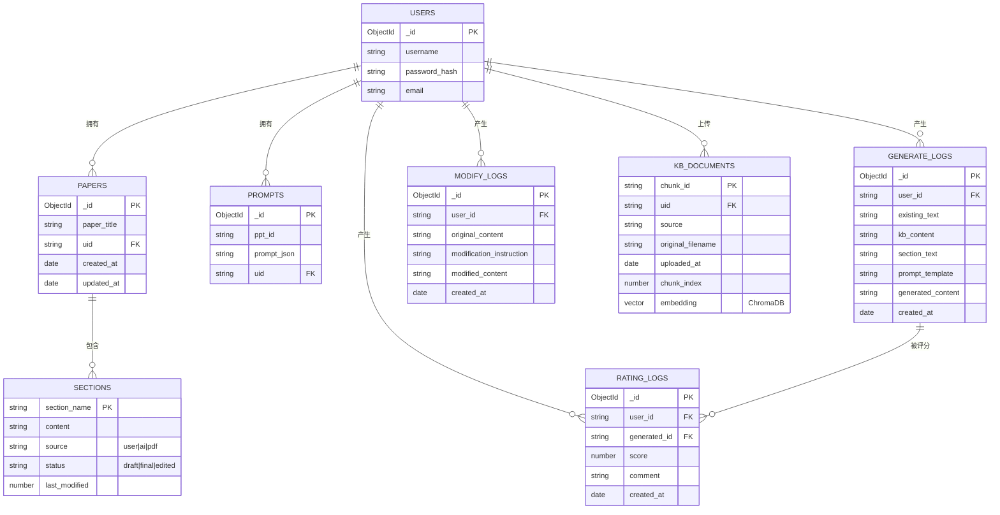
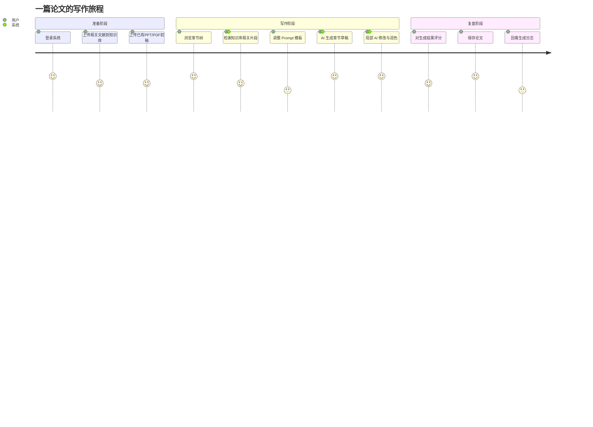

# AI 论文辅助系统 — 需求分析说明书

## 1. 引言

### 1.1 编写目的
本文档对 **AI 论文辅助系统（AIM）** 的业务背景、用户角色、功能需求和非功能需求进行系统化梳理，作为后续系统设计、开发、测试和验收的依据。

### 1.2 项目背景
随着学术论文数量与复杂度不断上升，研究人员在论文写作过程中面临如下痛点：
- 论文章节繁多，结构整理与版本管理繁琐；
- PPT/PDF 中已有素材难以快速沉淀为论文初稿；
- 需要频繁查阅相关文献，缺乏统一的知识检索入口；
- 单纯依赖大模型容易"凭空生成"，难以贴合已有材料与上下文。

为此，本系统将"**论文结构化管理 + 个人知识库语义检索 + LLM 辅助写作**"三者整合，形成一站式的科研写作助手。

### 1.3 项目目标
- 为用户提供安全的账号体系与论文私有空间；
- 支持从 PPT/PDF 自动解析为结构化论文章节；
- 在写作过程中提供基于"已有内容 + 知识库 + 章节参考"的 AI 内容生成与修改；
- 提供个人知识库（向量库）的上传、检索、删除等管理能力；
- 提供可定制的 Prompt 模板体系，沉淀写作经验。

### 1.4 术语与缩略语
| 术语 | 含义 |
|------|------|
| AIM | AI 论文辅助系统（AI Manuscript） |
| LLM | 大语言模型（Large Language Model） |
| RAG | 检索增强生成（Retrieval-Augmented Generation） |
| JWT | JSON Web Token，用户身份令牌 |
| KB  | Knowledge Base，个人知识库 |
| Embedding | 向量嵌入，将文本转换为高维向量 |

---

## 2. 系统总体描述

### 2.1 系统定位
一款面向科研人员、研究生的 **Web 端 AI 论文写作助手**，前后端分离，部署灵活。

### 2.2 技术栈概览
- 后端：FastAPI 0.116、MongoDB、ChromaDB、LangChain、OpenAI 接口、PyJWT、pdfplumber
- 前端：Vue 3.5、Element Plus、Vue Router、Axios、Vite
- 嵌入模型：HuggingFace `all-MiniLM-L6-v2`

### 2.3 用户角色
| 角色 | 描述 | 主要诉求 |
|------|------|----------|
| 普通用户（科研人员/学生） | 系统主要使用者 | 写论文、用知识库、用 AI 生成 |
| 系统管理员 | 后端运维人员 | 部署、配置、监控、日志管理 |
| 第三方系统 | 通过 API 集成的客户端 | 调用 RESTful 接口接入功能 |

---

## 3. 需求总体视图（系统上下文图）

---

## 4. 功能性需求

### 4.1 功能模块总览

### 4.2 用例图（用户视角）

> 说明：AI 生成内容 (`UC5`) 在执行时通常需要先进行知识库检索 (`UC9`) 并使用 Prompt 模板 (`UC11`)；上传 PDF 解析 (`UC4`) 是论文管理 (`UC3`) 的扩展用例。

### 4.3 详细功能需求

#### FR-1 用户认证模块（`/api/auth`）

| 编号 | 名称 | 描述 | 关键约束 |
|------|------|------|----------|
| FR-1.1 | 用户登录 | 用户名 + 密码登录，签发 JWT Token | Token 有效期 7 天 |
| FR-1.2 | 用户注册 | 新用户注册，密码 bcrypt 加密 | 用户名唯一 |
| FR-1.3 | 获取当前用户 | 由 Token 解析当前用户信息 | 必须携带 Bearer Token |
| FR-1.4 | 修改密码 | 用户修改自身密码 | 需校验旧密码 |

#### FR-2 论文管理模块（`/api/papers`）

| 编号 | 名称 | 描述 | 关键约束 |
|------|------|------|----------|
| FR-2.1 | 获取论文列表 | 返回当前用户所有论文 | 仅本人可见 |
| FR-2.2 | 上传 PDF 解析 | 上传 PDF 自动转结构化章节 | 仅 `.pdf`，文件名建议无空格 |
| FR-2.3 | 创建论文 | 手动创建新论文 | 标题对同一用户唯一 |
| FR-2.4 | 更新论文 | 编辑章节内容、状态、来源 | 章节状态：draft/final/edited |
| FR-2.5 | 删除论文 | 按标题删除论文 | 仅本人可删 |
| FR-2.6 | 查看论文详情 | 按 `paper_title` 查询论文 | 仅本人可见 |

#### FR-3 AI 辅助写作模块（`/api/ai`）

| 编号 | 名称 | 描述 | 关键约束 |
|------|------|------|----------|
| FR-3.1 | 内容生成 | 基于「已有内容 + 知识库 + 章节参考 + Prompt」生成新内容 | Prompt 模板使用 `$$` 占位符 |
| FR-3.2 | 内容修改 | 基于修改指令重写已有内容 | 调用记录写入 `modify_logs` |
| FR-3.3 | 用户评分 | 对生成内容打分 + 评论 | 必须关联 `generated_id` |
| FR-3.4 | 调用日志 | 记录生成/修改/评分日志 | 用于复盘与质量评估 |

#### FR-4 知识库管理模块（`/api/knowledge`）

| 编号 | 名称 | 描述 | 关键约束 |
|------|------|------|----------|
| FR-4.1 | 上传 PDF 入库 | PDF 文本提取 → 切分 → 向量化 → 写入 ChromaDB | 仅 `.pdf` |
| FR-4.2 | 语义检索 | 输入 `query` 与 `k`，返回相似度最高的 `k` 条 | 用户隔离（按 `uid` 过滤） |
| FR-4.3 | 查看来源列表 | 返回当前用户知识库的所有来源文档 | 按 `uid` 过滤 |
| FR-4.4 | 按来源删除 | 删除指定来源的所有 chunk | 仅本人可删 |
| FR-4.5 | 清空知识库 | 清空当前用户知识库 | 危险操作，需二次确认 |

#### FR-5 Prompt 模板模块（`/api/prompts`、`/api/user-prompts`）

| 编号 | 名称 | 描述 | 关键约束 |
|------|------|------|----------|
| FR-5.1 | 获取模板 | 按 `ppt_id` 获取 Prompt | — |
| FR-5.2 | 保存模板 | 新建/更新 Prompt | 同一 `uid + ppt_id` 唯一 |
| FR-5.3 | 用户 Prompt 管理 | 用户级别的 Prompt CRUD | 仅本人可见可改 |

#### FR-6 系统支撑功能

| 编号 | 名称 | 描述 |
|------|------|------|
| FR-6.1 | 统一响应格式 | `{success, message, data}` |
| FR-6.2 | 全局异常处理 | 5xx 错误统一返回 JSON |
| FR-6.3 | Swagger 文档 | `/docs` 自动生成接口文档 |
| FR-6.4 | 健康检查 | `/health` 返回服务状态 |
| FR-6.5 | CORS 支持 | 允许前端跨域访问 |

---

## 5. 关键业务流程

### 5.1 AI 辅助生成内容（核心流程）

### 5.2 PDF 上传到知识库流程

### 5.3 用户登录流程

---

## 6. 数据需求

### 6.1 主要数据实体（ER 视图）

### 6.2 数据隔离与安全
- 所有论文、Prompt、知识库均按 `uid` 进行隔离；
- 知识库检索在 ChromaDB 层使用 metadata 过滤；
- 密码使用 bcrypt 加密存储，绝不可明文。

---

## 7. 接口需求（外部接口）

| 接口类型 | 内容 | 协议/格式 |
|----------|------|-----------|
| 前后端接口 | RESTful API（统一前缀 `/api`） | HTTPS + JSON |
| LLM 接口 | OpenAI 兼容协议 | HTTPS + JSON |
| Embedding | HuggingFace 本地模型 | 本地调用 |
| 数据库 | MongoDB Driver / ChromaDB Client | TCP |
| 认证 | `Authorization: Bearer <JWT>` | 标准头部 |

---

## 8. 非功能性需求

### 8.1 性能需求
| 编号 | 指标 | 目标值 |
|------|------|--------|
| NFR-P1 | 普通 CRUD 接口响应时间 | P95 ≤ 500 ms |
| NFR-P2 | AI 生成接口响应时间 | P95 ≤ 30 s（取决于 LLM） |
| NFR-P3 | 知识库检索（k≤10） | P95 ≤ 1 s |
| NFR-P4 | 单进程并发 | ≥ 50 QPS（轻量接口） |

### 8.2 可用性与可靠性
- NFR-A1：服务可用性 ≥ 99%（开发期）；
- NFR-A2：异常情况下返回结构化错误信息；
- NFR-A3：日志记录关键操作（生成、修改、评分）。

### 8.3 安全性
- NFR-S1：JWT Token 校验所有受保护接口；
- NFR-S2：密码 bcrypt 加密；
- NFR-S3：用户数据按 `uid` 严格隔离；
- NFR-S4：CORS 在生产环境配置具体白名单；
- NFR-S5：`JWT_SECRET_KEY` 通过环境变量管理。

### 8.4 可维护性
- NFR-M1：路由按业务领域拆分（`routers/`）；
- NFR-M2：Pydantic schema 与路由解耦（`schemas/`）；
- NFR-M3：使用 Swagger 自动生成接口文档。

### 8.5 可扩展性
- NFR-E1：易于扩展新的 LLM 供应商；
- NFR-E2：易于扩展新的文档类型（如 docx、md）；
- NFR-E3：可水平扩展（无状态后端 + JWT）。

### 8.6 兼容性 / 部署
- 浏览器：Chrome、Edge、Firefox 最新版；
- 操作系统：Linux / Windows；
- 运行依赖：Python 3.8+、Node.js 20+、MongoDB 4.0+。

---

## 9. 约束与假设

### 9.1 约束
- 仅支持单 LLM 供应商（OpenAI 兼容协议）；
- 知识库当前使用单一 collection，按 `uid` 元数据过滤；
- PDF 解析在中文复杂排版下可能不完美，需后期人工修正。

### 9.2 假设
- 用户拥有可访问 LLM API 的网络环境；
- MongoDB 与 ChromaDB 在本机或局域网内可达；
- 用户具备基本的论文写作与文件上传能力。

---

## 10. 验收标准（摘要）

| 模块 | 关键验收点 |
|------|------------|
| 认证 | 登录成功签发 JWT，过期后无法访问受保护接口 |
| 论文管理 | 上传 PDF 后能看到对应论文与章节，可增删改 |
| AI 生成 | 能基于知识库 + Prompt 模板生成有意义内容，且写入日志 |
| 知识库 | 上传 PDF 后可以在检索中召回相关片段 |
| Prompt | 模板的保存与读取一致，占位符 `$$` 替换正确 |
| 安全 | 用户 A 无法访问用户 B 的论文/知识库 |
| 文档 | `/docs` 可以打开并查看完整接口文档 |

---

## 11. 需求追踪矩阵（节选）

| 需求编号 | 对应接口/路由 | 对应前端模块 |
|----------|---------------|--------------|
| FR-1.1 | `POST /api/auth/login` | `Login.vue` |
| FR-2.1 | `GET /api/papers/list` | `MainLayout.vue` (A 区) |
| FR-2.2 | `POST /api/papers/upload-pdf` | `MainLayout.vue` (A 区) |
| FR-3.1 | `POST /api/ai/generate` | `EditNodeDialog.vue` |
| FR-3.2 | `POST /api/ai/modify` | `EditNodeDialog.vue` |
| FR-4.1 | `POST /api/knowledge/upload-pdf` | `KnowledgeBase.vue` |
| FR-4.2 | `POST /api/knowledge/search` | `EditNodeDialog.vue` / `KnowledgeBase.vue` |
| FR-5.2 | `POST /api/prompts/save` | `PromptManage.vue` |

---

## 附录 A：系统功能层级图

```mermaid
graph TD
    A[AI 论文辅助系统] --> B1[用户认证]
    A --> B2[论文管理]
    A --> B3[AI 辅助写作]
    A --> B4[知识库管理]
    A --> B5[Prompt 模板]
    A --> B6[系统支撑]

    B1 --> B1a[登录]
    B1 --> B1b[注册]
    B1 --> B1c[修改密码]
    B1 --> B1d[当前用户信息]

    B2 --> B2a[论文列表]
    B2 --> B2b[上传PDF解析]
    B2 --> B2c[创建/更新/删除]
    B2 --> B2d[查看详情]

    B3 --> B3a[内容生成]
    B3 --> B3b[内容修改]
    B3 --> B3c[用户评分]
    B3 --> B3d[调用日志]

    B4 --> B4a[上传PDF入库]
    B4 --> B4b[语义检索]
    B4 --> B4c[查看来源]
    B4 --> B4d[按来源/全部删除]

    B5 --> B5a[获取模板]
    B5 --> B5b[保存模板]
    B5 --> B5c[用户Prompt管理]

    B6 --> B6a[统一响应]
    B6 --> B6b[全局异常]
    B6 --> B6c[Swagger 文档]
    B6 --> B6d[健康检查]
    B6 --> B6e[CORS]
```

## 附录 B：典型用户旅程（写一篇论文）

---

> 本文档由 AI 辅助根据当前代码库与既有设计文档梳理而成，可作为后续完善 PRD、SRS 与测试用例的基础。
